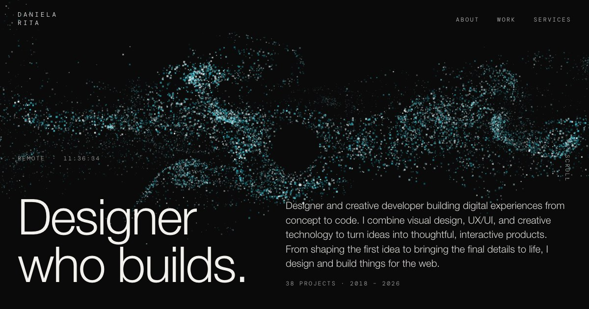

# Things I built

My portfolio site: websites and web apps I designed **and** built.

**Live:** [danielarita.com](https://danielarita.com)

- `index.html`: the page
- `demos/`: a working copy of each project, opened inside the page
- `media/`: demo videos and posters

Some demos are client or private work, so they aren't in this public code. You can see them on the live site.

**Built with:** HTML, CSS, JavaScript. No framework, no build step.
